# Fighter model brief

This brief is for a 3D artist making the fighters for **Fight Night**, a browser MMA game. The game draws simple 3D characters with toon shading and an ink outline, seen from the side, so they read as 2D art. Right now the fighters are placeholder shapes (spheres and cylinders) built in code. This brief describes the rigged models that will replace them.

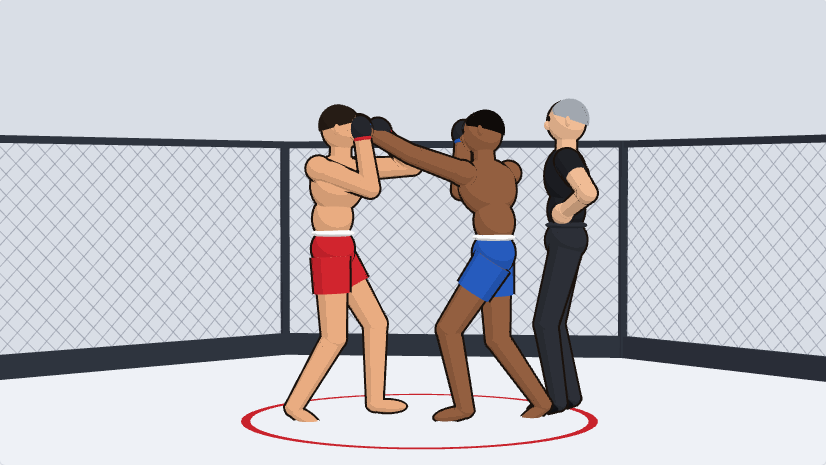

## How the game moves the model

There are **no animations to make**. The game poses the fighters itself, every frame:

1. It places about 17 joints in the world: pelvis, spine, chest, head, shoulders, elbows, wrists, hips, knees and ankles.
2. It solves the arms and legs with two-bone IK. Every strike, block, takedown, ground position and submission is a target for each hand and foot.
3. It rotates each bone of your skeleton to line up with those joints.

So the model needs the following:
- Bones that sit **exactly on the joints below**, with the proportions in the table.
- Weights that deform cleanly through very large ranges of motion, because MMA puts bodies in extreme positions.
- Material slots the game can recolor for gear.

## Deliverables (first round)

| File | What it is |
|---|---|
| `fighter_m.glb` | Male base fighter: body, head, eyes, MMA gloves, MMA shorts. Rigged and weighted. |
| `fighter_f.glb` | Female base fighter: the same skeleton and rules, with a sports top. |
| `hair_01.glb` … `hair_06.glb` | Six hairstyles, from shaved to long tied back. Each is skinned to the `head` bone only. |
| `shorts_thai.glb`, `shorts_grapple.glb` | Gear swaps: wide Muay Thai shorts and tight grappling shorts. They replace the base shorts and are weighted to the same skeleton. |
| `gloves_boxing.glb` | Boxing gloves, larger than the MMA gloves, for boxers and sparring. |
| `referee.glb` | A referee: the base body in a short-sleeved shirt, trousers and shoes. |
| Source files | `.blend` (or the source from whatever tool you use) with the rig, weights and shape keys. |
| `turnaround.png` | Front, side and back views of each base fighter in the rest pose. |

A working reference model is in the repo: [`public/models/fighter_test.glb`](../public/models/fighter_test.glb), built by the Blender script [`art/model-test/build_fighter.py`](../art/model-test/build_fighter.py). It has the right skeleton, material names and weights; it's just plain. To check your own file, put it at that path and run `npm test`. [`tests/model.test.ts`](../tests/model.test.ts) drives it through every standing, clinch, ground and submission pose and fails if any joint drifts more than half a centimeter. Then pick **Test model (beta)** under Fighter look on the main menu to see it in the game.

Before the final delivery, please send **one rigged test fighter** early. We'll load it into the game and run it through every pose. That way skeleton or weight problems show up while they're still cheap to fix.

## Skeleton

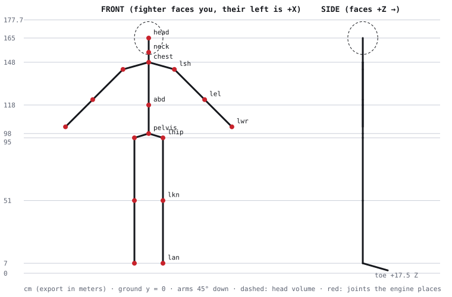

**Units and orientation**
- Model in real-world scale. glTF uses meters; the tables use centimeters.
- Y is up, and the ground is at Y = 0.
- The fighter faces **+Z**, and their own left is **+X**. That's the glTF default.
- The origin is on the ground between the feet.

**Rest pose:** standing straight, legs straight and hip-width apart, arms 45° down from horizontal, palms (fists) facing the thighs.

**Total height:** about 178 cm to the top of the head. All the ground and clinch poses were authored on these exact proportions, so match the joint positions within about 1 cm. If you want a different build (taller, longer arms), ask first. The game can read bone lengths from the file, but the grappling poses would need checking.

### Joint positions in the rest pose (cm)

| Joint | X | Y | Z | Notes |
|---|---|---|---|---|
| pelvis | 0 | 98 | 0 | Center of the hips. The whole body hangs off this. |
| abd | 0 | 118 | 0 | Mid spine, at about the navel. |
| chest | 0 | 148 | 0 | Upper chest, at the base of the neck. **The head turns about this point.** |
| spine_mid | 0 | 133 | 0 | Where the `spine` bone meets the `chest` bone. |
| neck | 0 | 155 | 0 | Throat. Not a bone joint, but chokes and the clinch grip aim here, so keep the neck there. |
| head | 0 | 165 | 0 | Center of the head (skull about 20 × 23 × 21 cm). |
| l/r shoulder | ±18 | 143 | 0 | |
| l/r elbow | ±39.2 | 121.8 | 0 | Upper arm 30 cm. |
| l/r wrist | ±58.3 | 102.7 | 0 | Forearm 27 cm. Glove center 5.5 cm beyond the wrist along the forearm. |
| l/r hip | ±10 | 95 | 0 | |
| l/r knee | ±10 | 51 | 0 | Thigh 44 cm. |
| l/r ankle | ±10 | 7 | 0 | Shin 44 cm. Toes about 17.5 cm forward of the ankle and the heel about 5 cm behind. |

### Bones

Use these names, so the game can find them without a lookup table. Each bone's head sits on the first joint and its tail on the second. Bone Y runs along the bone (the Blender and glTF default). Elbows and knees bend around the bone's local X axis. If your tool uses a different convention, tell us; it's a small table on our side.

| Bone | Parent | From → to | The game sets it from |
|---|---|---|---|
| `root` | — | ground origin | Position on the mat. Not weighted. |
| `pelvis` | root | pelvis → abd | The hip frame (lean and turn of the hips). |
| `spine` | pelvis | abd → spine_mid | The chest frame. The engine turns the whole ribcage with the chest, so spread the waist twist in the weights between `pelvis` and `spine`. |
| `chest` | spine | spine_mid → chest | The chest frame. |
| `neck` | chest | chest → head | Aimed at the head joint, turned with the head. |
| `head` | neck | head → top of head (178) | The head frame. |
| `clavicle_l/r` | chest | chest → shoulder | Fixed to the chest. Keep weights light. |
| `upperarm_l/r` | clavicle | shoulder → elbow | Aimed at the elbow from IK. |
| `forearm_l/r` | upperarm | elbow → wrist | Aimed at the wrist. |
| `hand_l/r` | forearm | wrist → glove center | Follows the forearm. **Wrists don't bend**: fists stay in line with the forearm. |
| `thigh_l/r` | pelvis | hip → knee | Aimed at the knee. |
| `shin_l/r` | thigh | knee → ankle | Aimed at the ankle. |
| `foot_l/r` | shin | ankle → ball of the foot | Points along the toe direction the game gives it. |

No finger, toe, face or twist bones are needed. Use at most 4 bone influences per vertex. Bones must have no scale.

## How far it has to bend

These are the current placeholder fighters in poses from the game. Your model goes into exactly these positions, so check your weights against them. The worst cases are listed first.

| | |
|---|---|
| 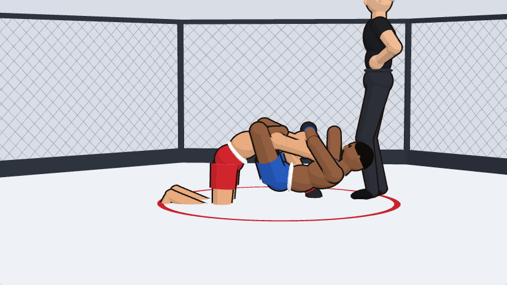 **Triangle choke**: legs wrapped around a neck and arm. | 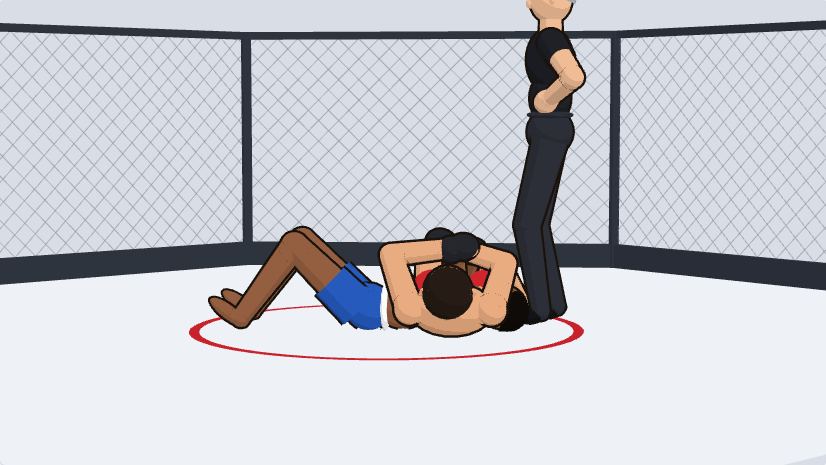 **Armbar**: a straight arm pulled across the hips, legs across the chest. |
| 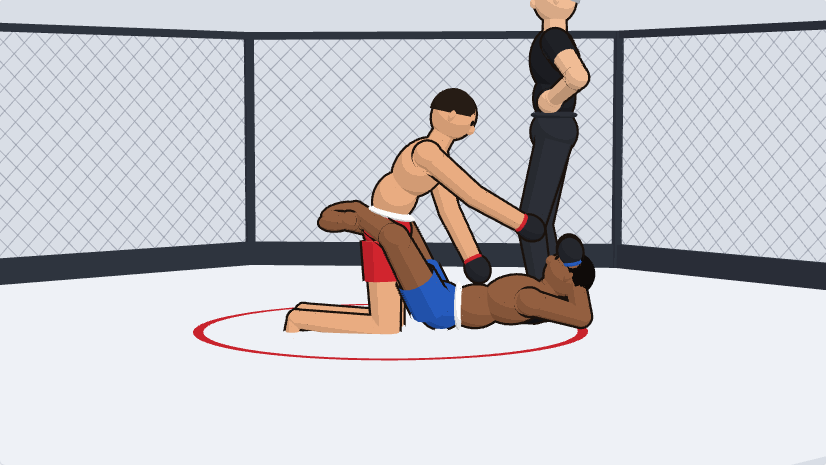 **Guard**: knees up by the chest, legs around a waist, punching down. | 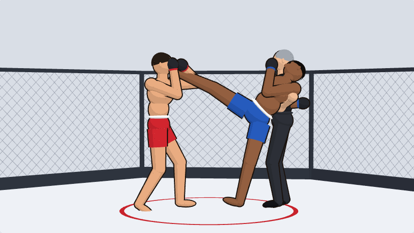 **Head kick**: leg at head height, hips turned over. |
| 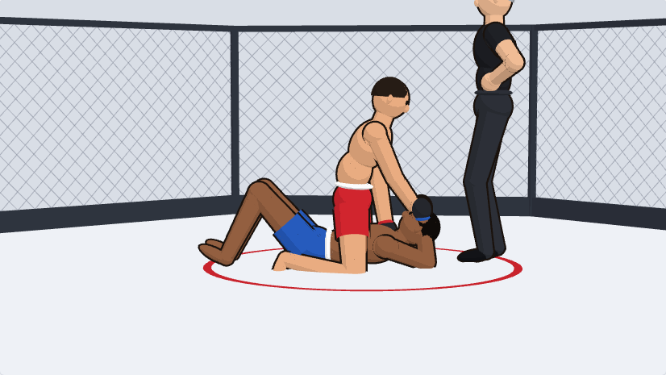 **Mount**: kneeling astride, deep knee bend, punching down. | 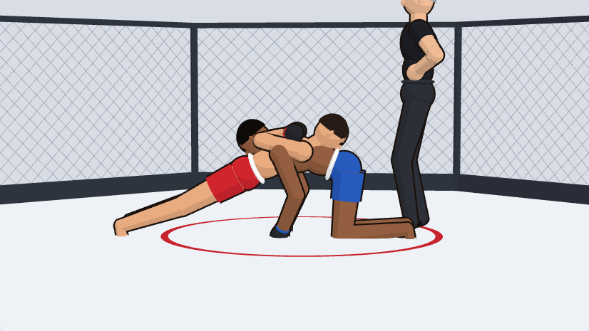 **Sprawl**: hips dropped on a shooting opponent's back, legs back. |
| 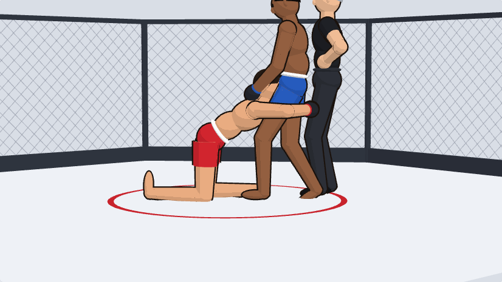 **Double-leg shot**: deep lunge, head at hip height. | 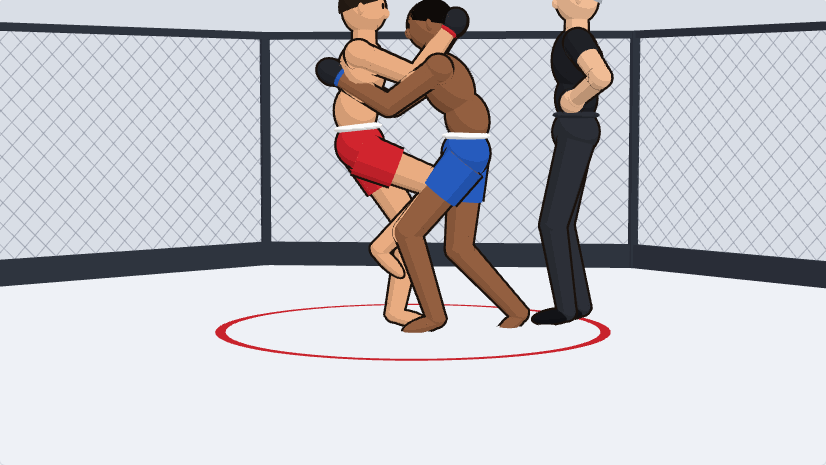 **Clinch**: hands behind the neck, knee to the body. |
| 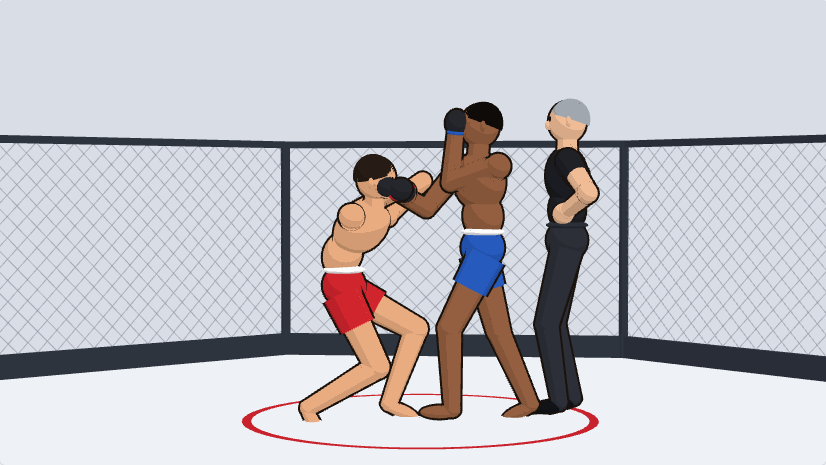 **Uppercut and duck**: deep squat, twisted torso. | 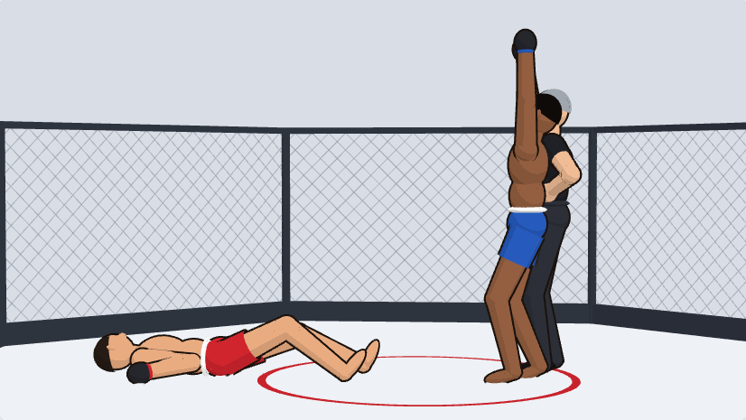 **Knockout and celebration**: flat on the back, arm straight up. |

All the reference images are in [`model-spec/poses/`](model-spec/poses), including the other strikes, side control and the cage drive.

**Ranges to support without collapsing or candy-wrapping:**
- Knees and elbows: 0–155°.
- Hips:
  - flexion to about 130°, for knee to chest in guard
  - abduction to about 70°, for head kicks and straddles
  - extension to about 30°, for the sprawl
- Shoulders: arm straight overhead (the celebration and high guard), across the chest (blocks and hooks), and behind the back (armbar).
- Spine: forward bend about 70° (shooting), side lean about 30°, and twist about ±45° between hips and chest (hooks, kicks).
- Neck: chin to chest, and head turned about 45°.

Add edge loops at the knees, elbows, shoulders and hips for these bends. Keep volume at the elbow and knee (no thinning when bent) and at the buttocks in deep hip flexion.

## Look

- **Shading.** The game lights everything with a 3-step toon ramp from one key light above and to the front, plus an ambient light. Soft gradients, ambient occlusion and normal maps won't show. Model the forms (pecs, abs, calves, kneecaps) as **shapes that catch a light and a shadow band**, or paint them as flat color areas.
- **Outline.** The game draws the ink outline itself by expanding each mesh about 1.1 cm along its normals. For that to work:
  - Each mesh must be **closed and smooth-shaded**, with no split normals or hard edges.
  - If you need a crisp edge, make it with geometry such as a bevel.
  - Separate pieces (hair, gloves, shorts) should be closed shells too.
- **Silhouette.** The camera is side-on and a long way back. On a laptop, fighters are about 400 px tall in fights and about 150 px in the park. On a phone they can be as small as 70 px. Readable shapes matter more than detail:
  - a clear chin and nose line in profile
  - distinct gloves
  - a waistband that separates torso from shorts
  - shorts that flare from the thigh
- **Proportions.** Athletic and slightly stylized, matching the placeholder: a slightly larger head and hands than real life is fine. Keep a lean welterweight build for the base. Heavier builds come from shape keys.
- **Polycount.** Up to 5 fighters can be on screen in the park, on phones. Aim for:
  - about 8,000 triangles for a whole fighter including hair and gear
  - a head of about 2,000

  No LODs needed.

## Colors and materials

The game recolors gear and skin at runtime, so **name the materials exactly** as listed. The colors you set are only a preview. One flat color per material is ideal. A small flat-color texture (512 × 512, no gradients) is fine if you need painted detail like tattoos or a logo; tell us which slot it belongs to.

| Material | Used for | Placeholder color |
|---|---|---|
| `skin` | Body, face, ears, neck | varies per fighter |
| `hair` | Hair, eyebrows, facial hair | varies |
| `eye` | Eyes (fixed dark) | `#16100c` |
| `shorts` | Shorts body | red `#c8232c` / blue `#2457b5` |
| `trim` | Waistband and side stripes on the shorts | `#f2f2f2` |
| `glove` | Glove padding | `#23252b` |
| `cuff` | Glove wrist strap and hand wraps | matches the shorts |
| `top` | Sports top (female base) | matches the shorts |
| `shirt`, `pants`, `shoe` | Referee clothes | `#1d1f24`, `#2a2d34`, `#111216` |

## Shape keys

Put these on the base bodies. Gear and hair should follow them where they overlap.

| Shape key | Range | Effect |
|---|---|---|
| `build_heavy` | 0–1 | Heavyweight: thicker torso, neck and limbs, a bit of belly. |
| `build_lean` | 0–1 | Flyweight-lean: narrower, more defined. |
| `face_hurt` | 0–1 | Wince: eyes squeezed, mouth open. Optional. |
| `face_out` | 0–1 | Eyes closed, jaw slack (knockout). Optional. |

## Export

- glTF 2.0 binary (`.glb`): Y up, +Z forward, meters, with skin, shape keys and materials.
- Export in the rest pose, with no animations.
- Apply all object transforms first (scale 1, no rotation on the mesh object).
- One armature per file, named `rig`. Meshes are named after what they are (`body`, `gloves`, `shorts`, `hair_03`).
- File names are lowercase with underscores, as in the deliverables table.

## What we check

- [ ] Joint positions match the table within 1 cm, and bone names match.
- [ ] Every pose in `model-spec/poses/` deforms without collapsing elbows, knees, shoulders or hips.
- [ ] Gloves stay round and in line with the forearm. Shorts don't tear at the inner thigh in a split.
- [ ] The outline is unbroken: no gaps at seams, and no black spikes from split normals.
- [ ] Recoloring each material slot changes only that part.
- [ ] Hair and gear swap on and off without gaps, and follow the build shape keys.
- [ ] Whole fighter at about 8,000 triangles or fewer.

## Not needed

- Animations or an animation rig with controls (the game poses the model itself).
- Finger, toe, face or twist bones.
- LODs, normal maps, PBR textures or physics.
- The cage, the street or props (those are built in code).

## Questions

Ask us about anything here that's unclear or that fights your workflow. The skeleton conventions and material names are the only things the code depends on directly; everything else is about the look, and we're open to suggestions.
